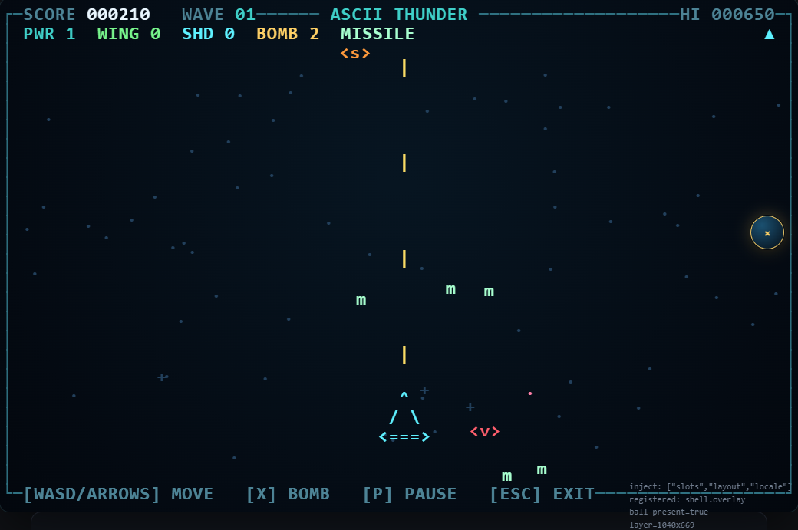

<div align="center">

# 字符雷霆 · ASCII Thunder

**把 DSH 的对话区，变成一场字符飞机大战。**

[](./package.json)
[](./LICENSE)
[](#一些技术内幕顺便解释为什么你会看到-canvas)
[](#它真的全是字符)

</div>



---

## 这是什么

一个 DeepSeek Harness（DSH）插件。装好之后，你的窗口右侧会多一颗青色小球。

点它，**当前对话区会变成一场纵版弹幕空战**：屏幕上正在显示的文字先被一片字符噪点从下往上扫散，然后星空亮起，你的战机从底部推上来，敌机从上面压下来。

再点一次，或者按 `ESC`，战场整层消失，对话原样回来——就像什么都没发生过。

**它真的全是字符。** 战机是 `^ / \ <===>`，敌机是 `<v> <s> <@> [W] [L] [X]`，子弹是 `|`，弹幕是 `* o ·`，血条是 `██████░░`，边框是 `┌ ─ ┐ │ └ ┘`。没有一张图片，没有一个位图像素。

---

## 三十秒上手

```bash
git clone https://github.com/<you>/ascii-thunder.git
```

1. 打开 DSH 左侧栏的 **插件** 页
2. **添加插件** → 选中这个仓库目录
3. **重启一次 DSH**（替换已安装插件的客户端文件要重启才会加载新代码）
4. 刷新页面，右边出现 `▲`，点它

不玩了：插件页里禁用或移除即可。想彻底干净，再清掉本地存储里的 `dsh.ascii-thunder.hi` 和 `dsh.ascii-thunder.ball`。

---

## 操作

| 输入 | 动作 |
| --- | --- |
| `WASD` / 方向键 | 移动（主炮自动开火，不用按着） |
| 鼠标在画面里移动 | 也可以带飞机——要先真的挪一段距离才接管，免得刚进来就跳到鼠标处 |
| `X` | 炸弹：清空敌弹、重创全场、附赠一段无敌 |
| `P` | 暂停 / 继续 |
| `R` | 重新开始 |
| `ESC` | 退出，回到对话 |
| 右键点击小球 | 把它放回默认位置 |

小球可以按住拖动，位置会记住。总有人想把它拖到角落，所以我们支持了。

---

## 里面有什么

- **主炮五级**：单发 → 双发 → 三向 → 四向 → 五向加尾炮。每一级都看得出来。
- **僚机**：最多两架，跟着你一起泼子弹。
- **副武器**：`M` 跟踪导弹（会自己拐弯找最近的敌人）、`A` 穿甲弹（高速、穿透）。
- **保命三件套**：护盾（最多两层）、炸弹（最多五枚）、三条命，判定点只有机体中心那一小块。
- **六种敌机**：侦察机、蛇形机、俯冲机、炮台（三向扇形弹）、激光机（先亮预警线再开火）、精英机（环形弹幕）。
- **BOSS**：每四波一个，两阶段；半血狂暴，弹幕换成螺旋加激光。血条画在状态行上。
- **掉落**：`P` 火力、`W` 僚机、`S` 护盾、`B` 炸弹、`M` 导弹、`A` 穿甲弹、`C` 水晶（加分）。

---

## 它不做什么

这一条比上面所有功能都重要：

- **不动你的对话。** 战场是一层独立浮层，贴着会话区画上去。关闭 = 把这层移除。消息、滚动位置、草稿、正在生成的回合，全都没被碰过。
- **不读你的内容。** 开场只**读一次**可见字符的位置（`Range.getClientRects()`），用来放粒子；不存、不发、不改写，也不进任何日志。
- **不写会话日志**，不加新的事件类型，不改 agent 的任何行为。

一句话：它只是一块盖在对话上面的、会打飞机的玻璃。

---

## 一些技术内幕（顺便解释为什么你会看到 canvas）

**为什么用 canvas 而不是 DOM？**
上一版试过用 `<pre>` 加成千上万个 `<span>` 拼字符网格，每帧重建一次。3000 多个格子 × 20 帧，浏览器忙着重排，你的风扇会比敌机先起飞。现在字符用等宽字体逐行 `fillText` 画在 canvas 上，60 帧，逻辑同帧率。视觉上还是字符，性能上不是同一物种。

**开场为什么要读文字？**
因为「正在生成的字被清走」这件事，必须真的看着那些字才知道它们在哪。所以我们量一次坐标，在自己的画布上把每个字按原本的字体和颜色重画一遍，再让它们被扫描线打散。原文一直在底下，只是被盖住了。

**为什么 BOSS 长着一张脸？**
因为字符画里 `<( o o )>` 已经是最高级的表情管理了。

---

## 已知怪癖（不算 bug，算性格）

- 右侧的文件 / 终端面板打开时，小球会叠在它上面一点点。拖开就好，位置会记住。
- 战场跟着会话区走：玩的时候切换会话，画面不会跳走，退出后看到的是当时选中的那个会话。
- 超长会话第一次进入时，量字坐标最多 1500 个字符，会有一点几乎察觉不到的取数耗时。
- 没有音效。字符是没有声音的。

---

## FAQ

**会掉帧吗？**
不会。掉帧说明你开着 4K 录屏，或者用的是 2013 年的核显。

**会读我的聊天记录吗？**
只读一次屏幕上可见字符的坐标，用来做开场粒子动画。不落盘、不联网、不改内容。介意的话，把这段代码翻出来看，`captureText` 一共 40 行。

**为什么不做移动端？**
因为这是个给键盘和鼠标的插件。硬要用触屏的话，指针也能带飞机。

**为什么叫「字符雷霆」？**
因为「ASCII 飞机大战」听起来像课程作业。

---

## 开发

没有构建步骤，改完就用。

```
ascii-thunder/
├── client.js          # 浏览器端全部逻辑：字符引擎、canvas 渲染、开场粒子、悬浮球
├── index.js           # Host 半身，只有一行 apply()
├── cordis.patch.yml   # 往 profile 里插一行
├── package.json       # dsh.bundle + dsh.client 声明
├── locale/{zh,en}.json# 插件页展示的标题与简介
├── docs/DETAIL.md     # 插件详情页
├── docs/preview.png   # 上面那张图
└── icon.svg
```

`client.js` 里 `#region game-engine` 到 `#endregion game-engine` 之间是纯 JS 的引擎与渲染，不依赖 React，也不依赖 DSH API——想单独跑它，把这段抠出来喂给 canvas 就行。

改完客户端代码要重启 DSH 才会加载新一代模块。

---

## 许可

[MIT](./LICENSE)。拿去改，改得比我好笑就行。
